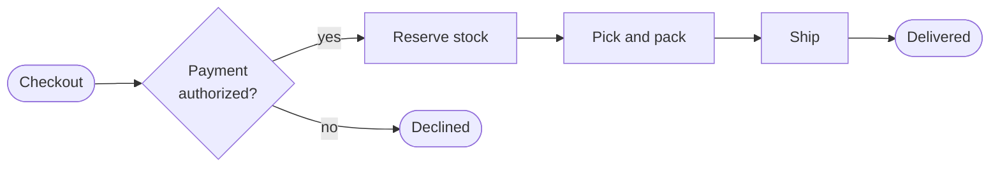
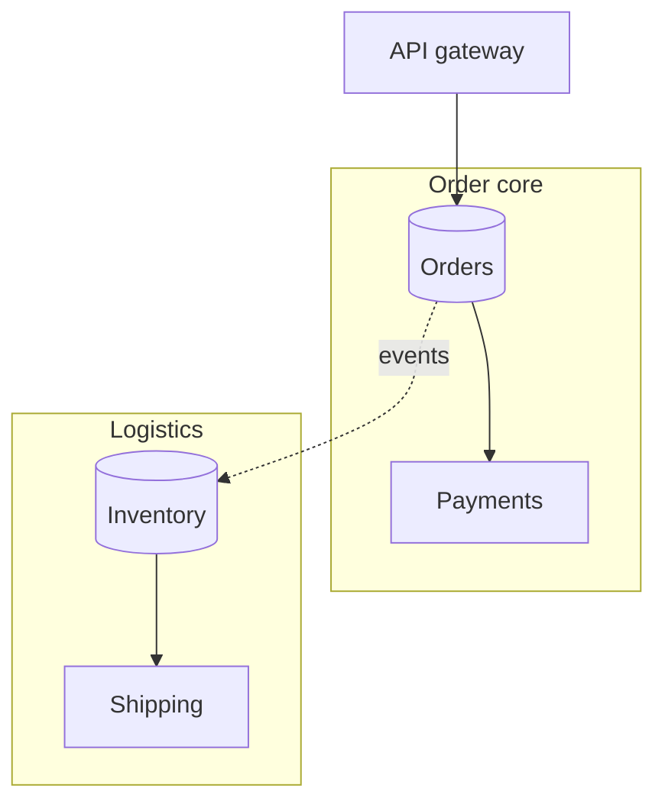
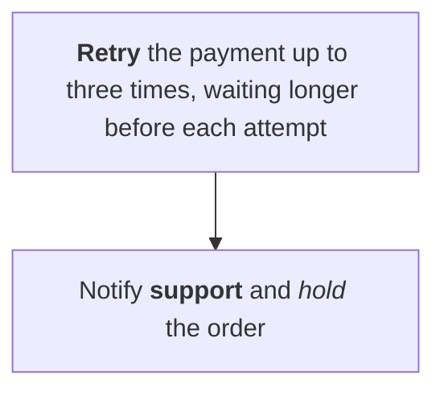

# Order fulfilment

How an order moves from checkout to the customer's door, and which service owns each step.

## The happy path

An order is accepted once payment is authorized and every item is reserved. Fulfilment then picks, packs and ships
from the nearest warehouse that holds all of the items.

## Services

Each service owns its data, and talks to the others through the event bus. Only the gateway is reachable from
outside.

## Labels

Labels may use **Markdown strings**, which wrap, and HTML, which styles a word.

